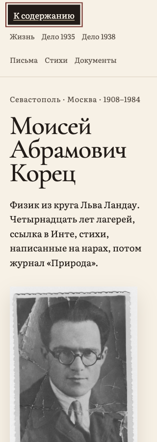

# UX/UI Follow-up — 2026-10-12

Reviewed `8182aa6`, including the four separate fixes `4b4de4e` (skip link), `59377b0` (navigation), `ab0ab7d` (image enlargement), and `8182aa6` (poem footnote names). No tracked site changes were pending. This review changed only this report and its two screenshots.

The image-enlargement change was subsequently reverted in `3f5236c` at the contributor's request. The current PR retains only skip-link visibility, mobile navigation, and footnote names. All ten image-bearing pages are byte-for-byte identical to the base branch; shared CSS has no enlargement rules. The browser evidence below was collected before that revert.

## Result

**The three retained fixes passed the browser checks below. Image enlargement is excluded from the current PR.**

- **Skip link:** On homepage and `pages/pisma12.html`, first Tab exposes a readable, outlined shortcut above the header. Fixed positioning/z-index 3 and center-point hit tests confirm it is on top. Enter moves to the content anchor; subsequent Tab proceeds to a content link.
- **Navigation:** All six section links remain fully within the viewport and unmasked at 320, 390, 768, and 1440px. Actual Tab/Shift+Tab traversal follows the expected order on both homepage and long letter; every focused header link has a visible solid outline and unobstructed hit test. The narrow layout has 44px-high targets. Its header is static (about 157px high on mobile, 109px at 768px), so wrapping does not cover text while scrolling; desktop remains sticky.
- **Footnotes:** Both references in `pages/главаii.html` expose “Примечание 1/2”; returns expose “Вернуться к строке с примечанием 1/2”. All four viewport widths pass the reference/return round trip. Returned reference lands around y=72px, below the desktop header or with the static mobile header scrolled away. Displayed archival marks remain intact.

## Scope and evidence

Used the existing local preview and Playwright browser, actual keyboard/link interactions, DOM bounds/computed styles, and visually inspected screenshots. Measured homepage, `pisma12.html`, `главаii.html`, `фотографии.html`, and `допрос15июня1938года.html` at 320×900, 390×900, 768×900, and 1440×900 CSS viewports: no horizontal document overflow or measured main-content clipping. Reduced-motion emulation was enabled for stable anchor checks.

## Limits and remaining preferences

This is a targeted browser review, not a full accessibility-conformance audit. No real device, screen reader, alternate browser engine, native zoom, or exhaustive interaction testing of every page. Caption/alt-text enrichment and alternate footnote typography remain editorial/optional refinements from the baseline, not blockers for these fixes. The parent-owned preview server was left running.
